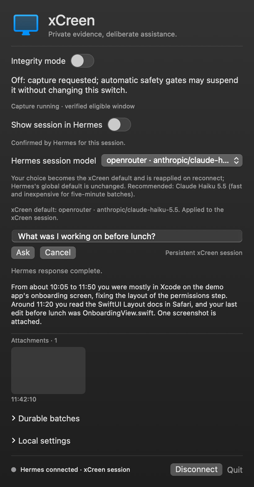

# xCreen — open-source screen memory for macOS

**Open-source (Apache-2.0) screen memory for macOS that writes useful, source-linked insights into your Obsidian daily notes, powered by your own [Hermes Agent](https://github.com/NousResearch/hermes-agent) and whichever models you configure.**

Looking for an open-source Rewind or Microsoft Recall alternative for Mac? xCreen is one, also comparable to Retrace, screenpipe and Goldfish, for people who already run Hermes Agent. [Website](https://al-ex-w.github.io/xCreen/) · [FAQ](https://al-ex-w.github.io/xCreen/faq/) · [Alternatives compared](https://al-ex-w.github.io/xCreen/alternatives/)

[](https://github.com/Al-ex-W/xCreen/actions/workflows/verify.yml)
[](LICENSE)
[](INSTALL.md)



<sub>The real tray view rendered offscreen with synthetic demo data (`scripts/render-screenshots.sh`); not a capture of anyone's screen.</sub>

> **Developer build.** Not notarized and not security-audited. Integrity (capture off) is ON by default.

## What it does

- **Menu-bar tray, Spotlight and CLI.** Ask questions about what you've seen from the tray, the macOS 26+ "Ask xCreen" Spotlight action (it fills the question in, you submit), or `xcreen ask` in a terminal.
- **Local capture with dedup.** Runs Apple Vision OCR on the foreground window at most once per second and drops text that is ≥90% similar to the last snapshot. Saves a screenshot every 10 active seconds.
- **Batches into one Hermes session.** Every 5 active minutes (or 30 images), a batch goes to a single persistent xCreen session in your Hermes Agent. It does not start a new chat each time.
- **Sourced insights in your Daily notes.** The model appends only useful findings to that day's note in your Obsidian vault, each linked to its captured evidence. If nothing is worth saving, the batch is marked skipped.
- **Integrity switch.** One switch, controlled only by you, stops all new screenshots and OCR. It is ON at first launch and keeps your choice across restarts.
- **7-day local retention, any model.** Raw evidence is deleted after seven days. You can pick any model your Hermes setup has configured. The default for the xCreen session is Claude Haiku 5.5 via OpenRouter.

## xCreen vs alternatives

Facts come from each project's own public pages, checked October 2026 ([sources](#sources)). Products change, so check the linked pages yourself.

| | xCreen | Rewind | screenpipe | Retrace | Goldfish | Microsoft Recall |
|---|---|---|---|---|---|---|
| Platform | macOS 14+ | macOS[^rw1] | macOS, Windows, Linux[^sp1] | macOS 13+, Apple Silicon[^rt1] | macOS, Windows[^gf1] | Windows 11 Copilot+ PCs[^ms1] |
| License / source | Apache-2.0, open source | — | Source-available Screenpipe Commercial License; personal non-commercial use free, commercial use needs a license[^sp2] | MIT, open source[^rt2] | Not covered here | Windows feature |
| Capture method | Foreground-window screenshots + local Vision OCR | Screen and audio recording[^rw1] | Accessibility tree, OCR fallback, audio transcription[^sp1] | Screenshots every 2 s + Vision OCR, SQLite FTS5[^rt1] | Foreground-window text via Accessibility, no screenshots[^gf2] | Periodic snapshots[^ms1] |
| Where AI runs | Whichever provider your Hermes route uses (OCR is local, inference usually isn't) | — | Local models (e.g. Ollama) or cloud AI, as you configure[^sp1] | No model inference listed as active[^rt1] | Cloud: Azure OpenAI via Cloudflare; memory stored locally[^gf2] | Processed locally on the PC[^ms2] |
| Writes to your notes | Yes, sourced entries in Obsidian Daily notes | — | — | — | Keeps its own local memory, exposed over MCP[^gf2] | — |
| Status | Developer build | Shut down: capture disabled Dec 19, 2025 after Meta acquired Limitless[^rw1][^rw2] | Actively developed[^sp1] | "Very early development"[^rt1] | Free beta[^gf1] | Available on supported PCs[^ms1] |

"—" and "Not covered here" mean we did not check a primary source for that cell. Rewind's AI features are left out because the app has been discontinued.

## Requirements and who it's for

xCreen suits Mac users who already run Hermes Agent, keep notes in Obsidian, and are fine using a developer build.

- **A working [Hermes Agent](https://github.com/NousResearch/hermes-agent) install is required.** xCreen does not include a model or keep API keys. It uses your Hermes profile read-only.
- **Local OCR does not mean local inference.** Batches and questions go to the provider behind your chosen route, and that provider's retention rules apply. For on-device inference, configure a local model in Hermes.
- **Developer build.** You build it from source with Swift/Xcode. It is not notarized. Use a stable signing identity so macOS keeps the Screen Recording permission across reinstalls.
- macOS 14 or later, Xcode/Swift and Python 3. The Spotlight action needs macOS 26 or later.

## Quick start

```sh
git clone https://github.com/Al-ex-W/xCreen.git && cd xCreen
bash scripts/install.sh           # builds, installs to ~/Applications, copies `xcreen` to ~/.local/bin
xcreen status                     # Integrity should report ON (capture paused)
```

Turn Integrity OFF from the tray when you want capture to start. See [INSTALL.md](INSTALL.md) for vault setup, signing, verification and uninstalling.

## Privacy and safety

- **What's captured** (only while Integrity is OFF and the Mac is unlocked and awake): screenshots and OCR text of the eligible foreground window.
- **Where it's stored:** in private files under `~/Library/Application Support/xCreen`, outside your vault and outside this repository. This storage is not encrypted, so use FileVault. Only distilled, source-linked insights go into Daily notes.
- **Retention:** raw evidence expires after 7 days. Anything already sent to your model provider or saved in Hermes history follows their retention rules. Deletion does not guarantee forensic erasure.
- **Excluded:** known password managers (1Password, Bitwarden, LastPass, Dashlane, KeePass, Apple Passwords, Keychain), System Settings, lock and login screens, and xCreen itself.
- **NOT protected:** browser password fields, password-manager browser extensions and popovers, and incognito/private windows are **not detected or redacted**. Turn Integrity ON before sensitive browsing.
- **Integrity is user-only:** only your tray or CLI action changes it. The model and screen content cannot turn capture on. Screen text is treated as untrusted evidence, never as instructions.

Full rules and limits: [SECURITY.md](SECURITY.md) · [How it works](docs/how-it-works.md).

## CLI

```sh
xcreen status
xcreen ask "What was the error I saw in the build log this morning?"
xcreen integrity on
xcreen models list
xcreen batches
```

Full command list and semantics: [docs/cli.md](docs/cli.md).

## Documentation

- [Install](INSTALL.md) · [CLI reference](docs/cli.md) · [How it works](docs/how-it-works.md)
- [Architecture](docs/architecture.md) · [CLI/tray parity](docs/cli-parity.md) · [Native durability](docs/durable-native-processing.md)
- [Implementation progress and limits](docs/implementation-progress.md) · [Working specification](docs/working-spec.md) · [Toolkit contract](docs/toolkit-contract.md)
- [Platform research](docs/platform-research.md) · [macOS session research](docs/macos-session-research.md) · [License research](docs/licensing-research.md)

## Contributing

Issues and pull requests are welcome. Read [CONTRIBUTING.md](CONTRIBUTING.md) and the [Code of Conduct](CODE_OF_CONDUCT.md). Don't put screenshots, OCR text or vault contents in issues. Report vulnerabilities privately as described in [SECURITY.md](SECURITY.md).

## License

[Apache-2.0](LICENSE) with [NOTICE](NOTICE), © Alexander Wahlström. Free for personal and commercial use. Redistributed forks must keep the Apache notices, but no advertising credit is required. Goldfish and Retrace were used as research references only. They are not dependencies, and no code was copied from them.

## Sources

[^rw1]: 9to5Mac, "Rewind Mac app shutting down following Meta acquisition", 2025-12-05 — https://9to5mac.com/2025/12/05/rewind-limitless-meta-acquisition/
[^rw2]: "What happened to Rewind" (the rewind.ai domain now belongs to an unaffiliated site) — https://rewind.ai/what-happened-to-rewind/
[^sp1]: screenpipe README — https://github.com/screenpipe/screenpipe
[^sp2]: screenpipe LICENSE.md — https://github.com/screenpipe/screenpipe/blob/main/LICENSE.md
[^rt1]: Retrace README — https://github.com/haseab/retrace
[^rt2]: Retrace LICENSE — https://github.com/haseab/retrace/blob/main/LICENSE
[^gf1]: Goldfish website — https://goldfish.sh
[^gf2]: Goldfish privacy documentation — https://docs.goldfish.sh/privacy.md
[^ms1]: Microsoft Support, "Retrace your steps with Recall" — https://support.microsoft.com/en-us/windows/retrace-your-steps-with-recall-aa03f8a0-a78b-4b3e-b0a1-2eb8ac48701c
[^ms2]: Microsoft Support, "Privacy and control over your Recall experience" — https://support.microsoft.com/en-us/windows/privacy-and-control-over-your-recall-experience-d404f672-7647-41e5-886c-a3c59680af15
